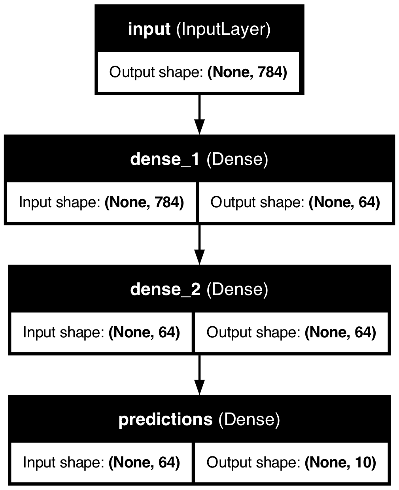
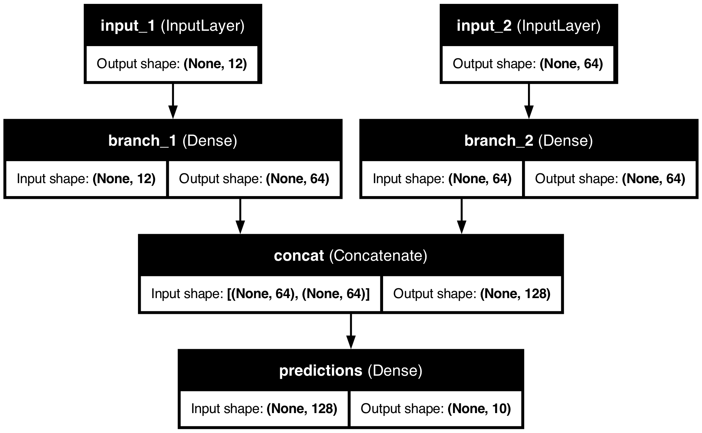
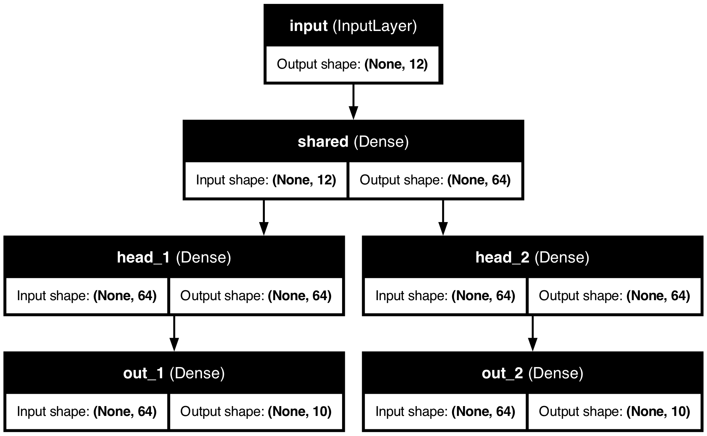
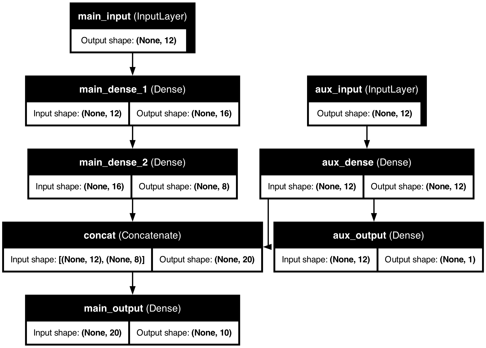

# Keras Examples

Short, self-contained scripts that show how to build Keras models beyond a plain `Sequential` stack: functional-API models with several inputs and outputs, editing an existing model's layers, and writing your own layer that can be saved and loaded.

Each script runs in a few seconds on a CPU, trains for one epoch on random data so you can see the expected input and output shapes, and draws its model as a PNG.

The code targets **Keras 3** (tested with Keras 3.15 on TensorFlow 2.21, Python 3.12).

## Contents

| Folder | Script | What it shows |
| --- | --- | --- |
| [`functionalKeras`](functionalKeras) | [`demoFunc_SingleInp_SingleOutput.py`](functionalKeras/demoFunc_SingleInp_SingleOutput.py) | One input, one output: a Dense stack written with the functional API |
| | [`demoFunc_MulInp_SingleOutput.py`](functionalKeras/demoFunc_MulInp_SingleOutput.py) | Two inputs merged with `Concatenate` into one output |
| | [`demoFunc_singInp_multiOutput.py`](functionalKeras/demoFunc_singInp_multiOutput.py) | One input, a shared layer, and two output heads with their own losses |
| | [`demoFunc_multiInp_multiOutput.py`](functionalKeras/demoFunc_multiInp_multiOutput.py) | Main and auxiliary inputs and outputs, with `loss_weights` |
| | [`replaceLayer.py`](functionalKeras/replaceLayer.py) | Swap an intermediate layer in an existing model while keeping the others' weights |
| [`creatingCustoumizedLayer`](creatingCustoumizedLayer) | [`myLayer.py`](creatingCustoumizedLayer/myLayer.py) | A custom trainable layer (`MyLayer`) |
| | [`buildModel.py`](creatingCustoumizedLayer/buildModel.py) | Build a model that uses `MyLayer` and save it to `model.keras` |
| | [`loadModel.py`](creatingCustoumizedLayer/loadModel.py) | Load that model back, custom layer included, and run a prediction |

## Setup

```bash
git clone https://github.com/Walid-Ahmed/kerasExamples.git
```

```bash
cd kerasExamples
```

```bash
python -m venv .venv && source .venv/bin/activate
```

```bash
pip install -r requirements.txt
```

Drawing the model diagrams with `keras.utils.plot_model` also needs [Graphviz](https://graphviz.org/download/) installed on your system (for example `brew install graphviz` on macOS or `sudo apt install graphviz` on Ubuntu). Without it the scripts still run and print a warning instead of the PNG.

## Functional API examples

Run each script from inside its folder so the diagram is written next to it:

```bash
cd functionalKeras
```

```bash
python demoFunc_SingleInp_SingleOutput.py
```

### One input, one output

The functional API passes tensors from layer to layer: `x = Dense(64)(inputs)`. A model is then defined by its inputs and outputs.



### Two inputs, one output

Each input has its own branch; `Concatenate` joins them. Training data is passed as a list in the same order as `inputs=[...]`.



### One input, two outputs

A shared layer feeds two heads. With more than one output, losses and metrics are given per output name:

```python
model.compile(
    optimizer="rmsprop",
    loss={"out_1": "categorical_crossentropy", "out_2": "categorical_crossentropy"},
    metrics={"out_1": ["accuracy"], "out_2": ["accuracy"]},
)
```



### Two inputs, two outputs

An auxiliary branch produces its own early output and also feeds the main output. `loss_weights` makes the auxiliary loss count less, and inputs and targets are passed as dicts keyed by layer name.



## Replacing a layer in an existing model

[`replaceLayer.py`](functionalKeras/replaceLayer.py) rebuilds a model's graph, calling every existing layer again except the one at `layer_id`, which is replaced by a new layer. The reused layers keep their trained weights.

```python
def replace_intermediate_layer_in_keras(model, layer_id, new_layer):
    model_layers = model.layers
    inputs = model_layers[0].output  # layers[0] is the InputLayer
    x = inputs
    for i in range(1, len(model_layers)):
        x = new_layer(x) if i == layer_id else model_layers[i](x)
    return keras.Model(inputs=inputs, outputs=x)
```

The script replaces `conv2` twice and prints the parameter count each time:

| Step | Layer at index 3 | Parameters | Diagram |
| --- | --- | --- | --- |
| Original model | `conv2` (Conv2D with bias) | 1,158 | [modelBeforeLayerReplacement.png](functionalKeras/modelBeforeLayerReplacement.png) |
| First replacement | `conv2_repl` (Conv2D, `use_bias=False`) | 1,154 | [modelAfterLayerReplacement1.png](functionalKeras/modelAfterLayerReplacement1.png) |
| Second replacement | `identity` (`Lambda`, no weights) | 1,010 | [modelAfterLayerReplacement2.png](functionalKeras/modelAfterLayerReplacement2.png) |

This approach works for chain-shaped models, where each layer feeds only the next one. Models with branches or skip connections need the graph rebuilt node by node instead.

## Creating a custom layer

[`myLayer.py`](creatingCustoumizedLayer/myLayer.py) defines `MyLayer`, a trainable linear projection `y = x @ kernel`. It shows the methods a custom layer needs:

- `__init__` stores the layer's settings.
- `build` creates the weights once the input size is known.
- `call` does the computation, using `keras.ops` so it runs on any Keras backend.
- `get_config` returns the settings, so the layer can be rebuilt when a saved model is loaded.

The class is decorated with `@keras.saving.register_keras_serializable`, so Keras can find it when loading.

```bash
cd creatingCustoumizedLayer
```

```bash
python buildModel.py
```

```bash
python loadModel.py
```

`buildModel.py` saves `model.keras`; `loadModel.py` loads it, prints the summary with `my_layer (MyLayer)` in it, and runs a prediction on a random sample.

## Updating from older Keras

These scripts were first written for Keras 2. The Keras 3 update changed:

- `Model(input=..., output=...)` to `Model(inputs=..., outputs=...)`.
- `keras.backend.dot` to `keras.ops.matmul` in the custom layer.
- Saving to the native `.keras` format instead of `.h5`.
- Per-output `loss` and `metrics` for multi-output models.
- `keras.Input(...)` in place of `input_dim=` on the first layer.

## License

No license file is included yet; all rights are reserved by the author unless one is added.
